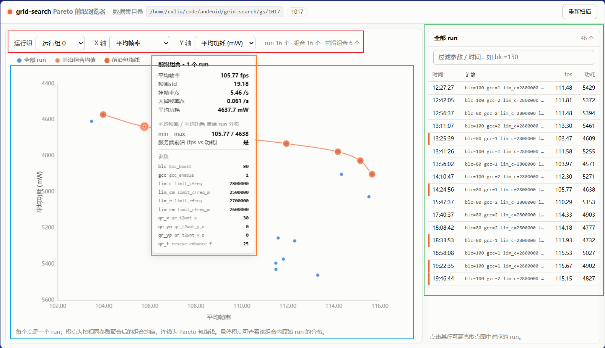

# FPSGO Param Automated Optimization Framework

自动化 FPSGO 参数搜索调优框架。在 MTK Android 设备上自动运行游戏做逐参数组合的实机调参，产出 Perfetto trace 文件及全面地 FPS/卡顿指标报告，支持断点续跑、剪枝早停。

## 工作流程

根据配置的搜索参数空间，遍历每个参数组合执行一次完整 run：

1. 等待设备就绪（如电量、温度到达阈值。如果温度不够，会进行自动热机），保证每次 run 时设备的起始状态接近
2. 初始化设备：亮屏、清理 logcat 、断开充电等
3. 进入具体游戏流程。对于具体游戏，可能包括重入游戏对局、开启 Perfetto 录制、模拟触摸进行自动化游戏
4. 早停校验，即当前配置在早期帧数明显低于一般情况（可选）
5. 游戏流程结束，停止 Perfetto、关闭游戏、熄屏、保存 trace 与录制元数据
6. 若单 run 失败（如遇到游戏强制护眼休息、预期外的广告弹窗），通过指数退避重试此 run

## 系统要求

- Python >= 3.12
- 已连接并授权 adb 设备；`adb devices` 能显示设备已经连接
- 目标设备的 `adb shell` 需要 root 执行权限

## 运行

### 从源码运行

克隆本仓库到本地，进入仓库目录。

推荐使用 [uv](https://docs.astral.sh/uv/) 管理 Python 虚拟环境。将模板配置文件复制为 `config.toml` 并修改相应配置。详见[配置](#配置)节。

修改完成后，运行 `src/main.py` 即可自动开始调参。搜索完毕后，会在命令行中输出简报，以及在 `output_dir` 下生成详细报告文件。

```bash
uv sync
cp config.example.toml config.toml
uv run src/main.py
```

> 运行前，请确保系统已经安装 adb，并且 adb 已经连接到目标设备。可用 `adb devices` 确认。

### 从 release 版本运行

先修改 `config.toml` 的对应配置。见[配置](#配置)节。

之后直接运行 `fpsgo-optim` 或 `fpsgo-tools` 即可自动开始调参。搜索完毕后，会在命令行中输出简报，以及在 `output_dir` 下生成详细报告文件。

## 配置

使用 TOML 进行配置。需要关心的配置主要在后续小节中。

默认如下（重要参数会标注"！！！"）：

```toml
output_dir = "gs/test"         # ！！！trace 与元数据输出目录

run_duration = 600             # ！！！单次有效录制时长（秒）
run_max_attempts = 8           # 单点最大重试次数
backoff_initial_secs = 15      # 重试初始退避（秒），之后指数翻倍
early_stop_dur = 60            # 提前停止检测窗口（秒）
early_stop_check_interval = 5  # FPS 采样间隔（秒）
early_stop_fps_threshold = 0   # 低于此平均 FPS 则提前结束/早停（0为永不早停）

repeats = 3                    # ！！！每参数运行组数量，见"运行组"节
shuffle_seed = 1017            # 运行组内乱序种子；null = 随机

# ！！！就绪温度的调节，见"就绪温度"节
ready_temp_battery = 35000     # 电池绪温度阈值
ready_temp_tsx = 35000         # tsx就绪温度阈值
ready_temp_soc_max = 35000     # soc_max就绪温度阈值

webui_port = 8787              # 结果预览网页端口

[grid]
# ！！！网格轴定义，见"grid语法"节

[power]
enable = true                  # 软断电开关
warmup = true                  # 游戏热机开关
charge_target = 100            # 每局前充到此电量
charge_wait_max = 7200         # 充电等待上限（秒）
warmup_secs = 900              # 热机兜底上限（秒）；正常达标即停用不到

[perfetto]
config_dir = "./perfetto_configs"        # .txtpb 配置目录（sgame.txtpb 等）

[sgame]
package_name = "com.tencent.tmgp.sgame"
package_name_short = "cent.tmgp.sgame"   # fpsgo_status 行匹配串
resource_dir = "./resources/sgame"
```

### grid 语法

Grid 网格轴配置用于灵活指定参数搜索组合。每个 toml 键是一条轴，最终搜索的是“轴内同步，轴间组合”的结果。

比如要搜索 a, b, c 三个参数的如下组合：

```
a = 1, b = 1, c = 10
a = 1, b = 1, c = 100
a = 2, b = 2, c = 10
a = 2, b = 2, c = 100
```

也就是，a 和 b 在 `1, 2` 内联合变动；c 在 `10, 100` 内变动；二者进行全组合（笛卡尔积）。对应的 grid 写法为：

```toml
[grid]
"a,b" = [1, 2]
c = [10, 100]
```

进一步地，也支持 a 和 b 联合变动，但各用不同的值：

```toml
[grid]
"a,b" = [[1, 100], [2, 200]]
```

这样会产出如下组合：

```
a = 1, b = 100
a = 2, b = 200
```

也支持指定单值，比如默认 a 参数为 2，但搜索中想让 a 为 200：

```toml
[grid]
a = [200]
```

总结如下：
| 形式        | 示例                                                         | 含义                                     |
| ----------- | ------------------------------------------------------------ | ---------------------------------------- |
| 单键        | `blc_boost = [100]`                                          | 单参数单值（也可多值）                   |
| 联合键·同值 | `"qr_t2wnt_y_p,qr_t2wnt_y_n" = [0, 30]`                      | 逗号分隔两个键，每项同时赋给两键（广播） |
| 联合键·异值 | `"limit_rfreq,limit_rfreq_m" = [[2700000, 2600000], [2800000, 2660000]]` | 每项是长度等于键数的元组，逐键取值       |

### 运行组

一个运行组，是对 `grid` 中的每个参数组合，即整个网格，进行**一次完整**的乱序遍历。

> 例如，若 grid 中有 4 个参数组合，repeats = 3，则总共会执行 12 次 run。

每个 run 都会收到其所在运行组编号，从 0 开始。

运行组的作用是：

- **重复执行**同一参数组合，保证结果的统计可靠性，避免偶然性
- 根据运行组编号执行**特定逻辑**。如让每一组运行不同的场景或对局

对于每个具体游戏，运行组的具体含义和作用**可能不同**。请查看具体游戏文档。

### 就绪温度

就绪温度是设备每次运行前需要达到的阈值温度。此配置的目的是：

- 统一进入游戏前的设备状态
- 设置一个较高的温度阈值，模拟设备在长时间游戏后的热机状态，以更贴近真实使用场景

阈值温度过低，就无法代表热机的真实使用场景；阈值温度过高，设备可能无法热机到位，或者完全脱离真实使用情况。所以需要根据经验设置一个合适的温度。

具体的阈值温度需要根据具体游戏和环境温度来调节。不同游戏真实使用场景下的设备温度可能不同。推荐的阈值温度请查看具体游戏文档。

## 支持游戏

在调优具体的游戏之前，请务必查看具体**游戏详细文档中的注意事项**等内容。

### 王者荣耀

王者荣耀国服(`com.tencent.tmgp.sgame`)。具体信息参考[王者荣耀](./docs/sgame.md)

### 和平精英

待兼容。此游戏无回放系统，故需要复杂的自动化操作流程来保证每一局负载可基本重现

### 原神

待兼容。情况同和平精英。

## 结果报告

TODO：改成 webui 的使用说明

程序搜索完毕后，框架会自动对结果进行分析。最终结果会通过 webui 进行可视化展示，通过 `http://localhost:<webui_port>` 进行访问。

webui 可视化界面如图所示：



- 红色框部分，可以选取特定运行组的结果进行浏览；分别为横、纵轴选取合适的统计指标，以浏览各指标下的结果
- 蓝色框部分是结果散点图以及最优点的包络线。根据上面设置的横纵轴指标进行渲染
- 橙色框部分是鼠标指针悬停到具体运行 run 的散点时显示的具体信息。包括结果指标、参数组合等
- 绿色框部分是结果表格，显示了当前选定的运行组下的所有 run 的信息列表

指标口径（均来自 Perfetto `actual_frame_timeline_slice`）：

| 指标      | 含义                                                         |
| --------- | ------------------------------------------------------------ |
| 平均帧率 | 每秒帧数 FPS（按 1s 分桶计算，丢弃首尾不完整桶后取平均）     |
| 帧率波动 | 逐秒 FPS 的标准差，衡量帧率稳定性                           |
| 掉帧率 /s | 每秒平均掉帧次数。掉帧 = 相邻帧的呈现间隔超过 12ms（120Hz 一帧的 1.5 倍），即人眼可感知的轻度卡顿；按对局时长归一成每秒次数 |
| 大掉帧率 /s | 每秒平均大掉帧次数。大掉帧 = 呈现间隔超过 16.67ms（错过一整帧）及 125ms（严重卡顿）两级，比普通掉帧更影响体验 |
| 平均功耗 | 电池侧放电功率的平均值（mW），来自 Perfetto 的 battery counter（`batt.power_mw` = 电流 × 电压）。跑局期间充电被软件切断，因此数值即整机功耗，可直接跨参数组合比较 |

## 注意事项

- 全自动操作真机：会强停/重启游戏、自动进回放、改 sysfs、长时间占屏，跑批期间设备不可他用

- 游戏 UI 自动化依赖 `resources/<game>/` 下的模板图与固定点击坐标，换机型/分辨率需重新截图
